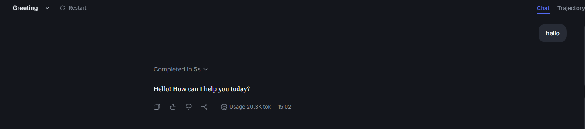
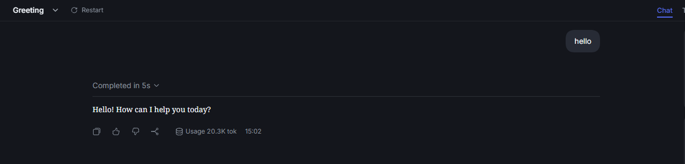

# dsh-session-panel-centering

A DeepSeek Harness (DSH) UI plugin that keeps the conversation centered when the Session panel is docked beside it.

DSH normally pins the transcript toward the start edge when the Session panel opens. This plugin overrides the host's chat end inset so the transcript and composer stay centered in the space beside the panel.

## Install

In DSH, open **Plugins → Add plugin** and install:

```text
dsh-session-panel-centering
```

Or use the DSH CLI to install it into a profile. The `plugin` command forwards its remaining arguments to pnpm in that profile's directory:

```bash
dsh plugin --profile <profile> add dsh-session-panel-centering
```

For example, to install into the `web` profile:

```bash
dsh plugin --profile web add dsh-session-panel-centering
```

This requires `dsh` on your PATH. To remove it later, run `dsh plugin --profile <profile> remove dsh-session-panel-centering`.

Requires DSH `^0.2.3-alpha.2`.

## Preview

Before, DSH pinned the transcript toward the start edge when the Session panel was open:



With the plugin, the transcript stays centered in the space beside the panel:



## How it works

The host sets `--dsh-chat-end-reserve` when a session panel or other side content needs space. This plugin sets `--dsh-chat-end-inset` to that reserve, which re-centers the transcript column instead of leaving a dead gutter. It only changes CSS; it does not touch conversation data or settings.

## Development

```bash
npm pack --dry-run
```

The package exports `./index.js` (host half, no-op), `./client.js` (Client UI module), `./icon`, and `./locale/*.json`.

## License

MIT — see [LICENSE](LICENSE).
